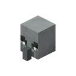
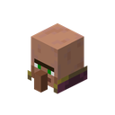
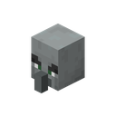

<h1 class="tv-hero__title">Talking Villagers</h1>

Villagers, witches, wandering traders and illagers talk – with real recorded voices instead of “hmm”.

<a class="md-button md-button--primary" href="installation/">Download</a>
<a class="md-button" href="making/web-editor/">Record your own voice</a>

It's a pleasure to see you!
I really like you!
Who will I torture today?
Do you want to buy something?

There! Get them!
You look funny!
Wololo!
See you!

Talking Villagers gives the mobs of a village real voices. They greet you, gossip,
complain about the rain, scream for help when zombies come, whisper while hiding from a
raid – and illagers taunt you in battle. With subtitles of what they say, if you like.

The voices come in **voicepacks**: single `.voicepack` files you drop into the game.
Anyone can record their own in the browser with the [web editor](making/web-editor.md).

!!! warning "Beta"
    Version 2 is a beta for testing. Back up your worlds before trying it. See
    [Beta notes](beta.md).

## Who talks

[[entities]]

The lines on the cards are examples: what an entity says is up to the voicepack.

## How it works in short

<ol class="tv-steps">
<li>:mc-book:<strong>Install</strong> Put the mod into your <code>mods</code> folder, on Fabric or NeoForge.</li>
<li>:mc-written_book:<strong>Voicepack</strong> Drag a <code>.voicepack</code> file into the voicepack screen.</li>
<li>:mc-name_tag:<strong>Voices</strong> Every villager gets its own voice and pitch, and keeps it.</li>
<li>:mc-bell:<strong>Listen</strong> Walk through a village: they greet you, chat and react to what happens.</li>
<li>:mc-goat_horn:<strong>Record</strong> Make your own pack in the web editor and share it.</li>
</ol>

New here? Start with [Installation](installation.md) and then
[Your first voices](getting-started.md).

## Features at a glance

- **Seven entities:** villagers, wandering traders, witches, pillagers, vindicators,
  evokers and illusioners, in [67 situations](making/events.md) from `greeting` and
  `trade` to `panic`, `hide`, `combat`, `patrol` and `wololo`.
- **Male, female and child voices.** Babies only get child voices and a new adult voice
  when they grow up. Every entity keeps its voice and a personal pitch.
- **Reacts to the situation:** your reputation (warm or cold greetings), raids, zombies,
  profession, weather and time of day.
- **[Languages](talking/languages.md):** each pack has a language. Every village can
  speak its own one, children inherit their parents' language.
- **[Voicepack screen](playing/voicepack-screen.md) in game:** install by drag and drop,
  turn packs on and off, listen to every line, change the settings.
- **[Multiplayer](playing/servers.md):** the server decides who says what. Players who
  lack the server's packs are offered a download when they join; players without the mod
  hear vanilla sounds.
- **[Commands](commands.md)** to change voices, genders and languages and to let entities
  say a line.
- **[Web editor](making/web-editor.md)** with recording studio, noise removal and export,
  right in the browser.
- Works on **Fabric and NeoForge**, Minecraft 26.3, in singleplayer and on servers.
